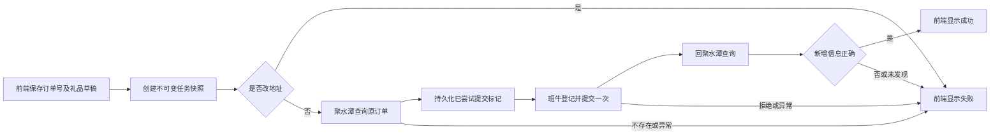

# 礼赠登记业务流程

编排、持久化、状态回传、单次提交及失败不自动重试已实现。Selenium 页面适配入口为 `gift_registry/platform_operations.py`，班牛保存任务的回执由 `banniu_receipt.py` 读取。正式业务入口为 `configured = True`，不使用模拟成功结果。真实平台与隔离测试的验证范围见 [v1.0.0 发布说明](releases/v1.0.0.md)。

本版本只处理原地址礼赠，不读取、解密或核对收件信息。前端的改地址草稿交互保留；`change_address=True` 的任务在任何平台查询、提交前返回失败，提交次数为 0。

## 执行顺序

逐行串行处理，单行失败后继续处理其他独立订单；失败行不会返回班牛再次提交。状态轮询只读取结果。

## 后端接口

1. `GET /api/config`：获取本地请求校验 Token、礼品目录、`workflow_configured` 和 `automatic_registration_retry: false`。
2. `PUT /api/rows`：前端发送当前草稿，包含字符串订单号 `order_no`、礼品名称 `gift`、多选标识 `gift_ids`、`change_address` 及可选收件信息。写入时检查草稿版本。
3. `POST /api/registrations/start`：请求体为 `{"revision": 当前草稿版本}`。后端固定已保存且版本一致的草稿，校验全部非空行，再派发任务。有新的原地址任务需要执行时，先取得并保留登录配置锁；环境冲突返回 HTTP 409、`code=registration_not_started`，不创建任务、不改写既有待接入快照、不产生新的失败记录。全部终态复用和改地址拒绝不抢占浏览器配置。业务尚未配置时仅保存待接入任务。
4. `GET /api/registrations/status`：返回每行 `state`、`detail`、`task_id`、`attempts`、`signature` 及更新时间；前端仅将签名匹配当前草稿的结果显示到状态栏。查询不会触发登记。

写请求使用 `/api/config` 返回的 `X-CSRF-Token`。执行结果只能由后端写入，不接受前端上传的成功状态。

## Selenium 操作接口

### `query_order(order_no) -> OrderSnapshot`

在聚水潭查询订单，首次保存基线、提交后用于复查。返回：

- `order_no`：精确匹配原订单号，保留前导 0。
- `found`：是否找到该订单。
- `records`：当前订单信息，每项为 `GiftRecord`，包括稳定且唯一的 `record_id`、商品编码集合 `gift_ids`、对应数量 `gift_quantities` 和关联凭证 `reference`。真实页面解析保留原商品与已有礼品，不能只取本次要登记的编码；无凭证时保留空字符串，不猜测。
- `recipient`：为兼容数据结构保留，本版本真实查询不读取收件信息，返回 `None`，也不将原收件信息作为成功条件。

记录标识必须能区分既有记录与新记录。首次已存在的正确礼品不会被当成本次新增登记成功。页面中使用 SKU 或其他编码时，适配器负责映射到 `config/gifts.json` 的本地 ID。

### `submit_registration(request, before) -> SubmissionReceipt`

在班牛按查询结果填写礼品并提交一次。

- `request.order_no`、`request.gift_ids`、`request.gift_names` 为本次订单及礼品。
- 本版本只接受 `request.recipient=None`。旧的隐藏地址草稿不会传给业务操作；显式改地址请求会被提前拒绝。
- 提交前按订单号查询班牛已保存任务，形成旧任务 ID 基线；表单中的全部礼品加入同一任务，最终核对后仅点击一次“提交”。
- 提交后只读查询新增任务详情，核对订单、补发类型、赠品补发、全部商品及数量、自动确认设置，并要求同步成功、回传的聚水潭单号在提交前不存在。回执包含 `accepted=True` 及 `created_record_ids`；无独立关联字符串时 `reference` 为空。
- 班牛回执通过仍不直接表示登记成功；必须经过聚水潭复查。
- 此方法内部不得添加自动提交重试，超时也不可再次点击提交。

`BanniuPage.submit` 已实现单次点击及只读回执核对，正式自动登记已启用。如果显式关闭 `configured`，适配入口会在打开浏览器、填写或点击前拒绝提交。旧的待接入任务不会在服务启动时自行执行，需要明确点击开始。生产代码不使用 `tests/fakes.py`。

可选的 `wait_for_verification(request, before, receipt)` 仅执行有界只读复查，默认最多查询 4 次、间隔 2 秒。出现新增但信息不一致、原订单缺失或查询异常时立即停止；不会回到班牛重新提交。最终仍由统一核验函数决定成功与失败。

## 会话过期后的登录恢复

登录助手和生产页面导航到已核对的受保护入口后，若出现官方 HTTPS 登录表单，则通过 Selenium 使用本机 DPAPI 配置尝试一次账号密码登录。班牛公开首页不作为登录依据，最终须回到礼赠工作表；聚水潭须出现订单区域与查询框架。验证码、二次验证、密码错误或结果不确定时保留窗口并显示人工处理提示，自动保存轮询不会重复填密码或点击登录。

聚水潭订单采集和班牛任务查询被登录打断时，只有实际恢复认证后，才可最多完整重查一次。班牛提交后的回执恢复只做有界只读查询，保持原任务 ID 基线和提交时间。表单中途失效或提交异常时，可恢复登录供人工核查，但当前任务仍失败，不重新填写或再次点击提交。历史成功／失败和已尝试标记不受登录恢复影响。

过期登录页和验证码阶段不覆盖上次完整会话快照；关闭助手只保存／清理，不触发自动登录。

## 成功与失败

只有原订单号一致、出现提交前没有的新记录、礼品集合及数量正确（每项 1 件）时才成功。同编码跨新增记录累计，重复或超量均失败；原订单数量不计入新增。提交返回关联凭证或记录 ID 时复查必须同时满足所有已提供的关联条件。本版本不核对姓名、电话和地址。

回执提供记录 ID 时，其集合必须与本次复查发现的全部新增记录 ID 完全一致；提供关联凭证时，每条新增记录都必须匹配该凭证。回执之外的新增记录不能被过滤后忽略。因此，同一订单在核验期间被其他人新增单据，也会保守返回失败并要求人工核查，不会自动重提。当前真实班牛页面回传一个售后单内部单号；如未来回传多个或无法完整解析，必须失败，不能只取其中一个判成功。

改地址请求、查询失败、订单不存在、班牛拒绝或提交异常、回执不符、复查异常、无新增信息、礼品或数量错误，均显示失败。鼠标停在状态标签可查看原因。

## 防止自动重复登记

- 在调用班牛提交之前，先把 `submit_attempted=True` 和 `attempts=1` 写入磁盘，写入不成功不会提交。
- 相同订单、礼品和实际收件设置形成业务标识，与表格行 ID 无关。重复点击、复制到另一行、放入另一批次，都复用已有终态，不自动重复登记。
- 失败是终态；没有自动重试次数、回退到登记阶段或失败后重新入队的逻辑。
- 提交结果不确定时保留失败并提示人工核查。已有提交标记的任务不能因换行或换批次重新提交。
- 服务重启时，中断任务标记失败，不自动恢复登记。成功 / 失败结果与任务快照、逐阶段事件保存在 `data/registration_jobs/`。
- 缺少有效新增记录 ID 证据的历史成功结果，读取时按失败处理，继续阻止重复登记。缺少逐行执行记录的任务不得直接重建为待执行；仅明确旧版的待接入快照允许兼容恢复，其他情况要求人工核查。
- 派发前拒绝缺失、空白或重复的行 ID，避免同一批次查重时错误排除另一行。
- 人工提交可通过 `record_external_submission` 加入同一持久化防重复机制：未完成核验时保留失败和已尝试标记；只有提交前后快照及回执核验通过，才升级为成功。此方法不派发队列、不调用平台提交、不改用户草稿。
- 恢复任务前先独占任务目录的内核文件锁，防止不同端口或进程并行恢复、执行同一任务。关闭工作台时等待在途工作结束后释放任务与浏览器配置锁。
- 浏览器配置锁在接收需要执行的新任务前预留，直到业务浏览器正常关闭，防止检查后又被登录助手抢占。存档失败且没有其他已接收任务，或所有任务结束且从未打开浏览器时，只回收空预留，不关闭已有浏览器。环境检查失败后不会自动重新开始；既有失败终态也不会因此恢复。

如以后需要人工重试，应单独设计明确操作和重复登记核查；本版本没有自动重试或人工重试入口。
