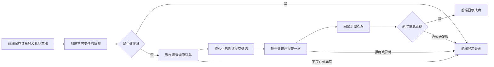

# 礼赠登记业务流程

局域网连接异常只影响页面获知结果，不等于业务没有执行。HTTP 写请求超时后不自动重发；服务重启导致旧连接凭据被拒绝时，只读更新凭据、保留未保存内容，由用户再次明确操作。恢复后的状态读取、草稿同步继续保留多设备版本校验和原有防重依据。详见 [局域网修复说明](releases/v1.2.0-lan-reliability.md)。

编排、持久化、状态回传、单次提交及失败不自动重试已实现。Selenium 页面适配入口为 `gift_registry/platform_operations.py`，班牛保存任务的回执由 `banniu_receipt.py` 读取。正式业务入口为 `configured = True`，不使用模拟成功结果。历史平台验证见 [v1.0.0 发布说明](releases/v1.0.0.md)，本轮分组及定时任务的隔离验证见 [v1.1.1 版本说明](releases/v1.1.1.md)。

本版本只处理原地址礼赠，不读取、解密或核对收件信息。前端的改地址草稿交互保留；`change_address=True` 的任务在任何平台查询、提交前返回失败，提交次数为 0。

v1.2.0 按本轮确认继续禁用改地址。原工作流、平台入口、班牛准备/提交、主机重登及延迟只读复核的地址限制全部保留；不改地址时 `RegistrationRequest.recipient=None`，隐藏草稿收件信息不进入平台业务请求。地址字段、班牛回执地址以及聚水潭本次新增单据地址的真实核对留待后续版本，不能把历史 `Recipient` 结构视为已接入。

## v1.2.0 表格与主机管理

礼品身份始终由 `gift_ids` 决定。已确认编码不再用展示名称反向匹配；同名不同编码可以同时选择并刷新恢复。内部剪贴板 v2 随文本矩阵携带每格编码，并继续接受旧矩阵格式；纯文本歧义保留为待匹配。区域来源与目标不一致时，每个维度取较大尺寸、按来源循环填满；筛选中不写隐藏行，不允许超出当前可见行新增，错误校验整次回滚。

新增写接口仍校验真实回环连接、本机 Host、Origin 和 CSRF：

- `POST /api/registrations/retry-all`：`failure_ids` 为本次明确选中的固定失败标识列表。接收时持队列锁，批内使用现有单条重登创建逻辑；执行仍在同一串行队列。每项返回 accepted/reused 或拦截原因。不会循环领取本批次新失败，重放失败标识不生成第二次提交。
- `POST /api/rows/status`：携带 `revision`、`row_ids`、`status`（`success`、`failed`、`pending` 或空字符串恢复自动显示）。只对签名匹配的已结束订单保存独立人工标记及事件审计，不写 `registration_jobs/`。普通人工标记绑定草稿签名，后台时间更新不使其失效；人工成功按订单摘要保留，可从旧标记及审计只读恢复，直到主机明确修改或恢复自动显示。状态接口附加 `manual_status`，自动 `state` 保持真实核验结果。
- `POST /api/rows/delete`：携带 `revision`、`row_ids` 或 `all: true`。空闲时持草稿锁及队列锁，先完整备份到 `draft_archive/`，再通过正常 revision 写入草稿。不会清空任务、执行历史、防重记录、人工标记审计或导出文件。前端撤销只恢复草稿。

人工成功不能作为新增记录核验成功，不计入成功 Excel；人工失败不能重新开放已成功或提交不确定订单的重登资格。自动归档跳过存在有效人工标记的行。原有“删除行”草稿编辑保留；新增主机批量删除另有备份、空闲与权限检查。

IP“删除提醒”只在当前浏览器持久化本次提示身份。网络恢复或新的提示身份解除隐藏，不调用核对接口，不变更 DNS 或共享配置。

班牛进入列表及只读刷新前固定工具浏览器 CSS 视口为 1440×900，页面缩放为 1；已有未提交表单先拦截。列表就绪仍要求已核对的工作表标题、唯一新建按钮、唯一表格及点击位置无遮挡；找不到按钮不通过脚本强行点击，不重试提交。2026-10-28 真实 Selenium 只验证了加载、新建空白表单及关闭，未提交真实订单。

## 执行顺序

逐行串行处理，单行失败后继续处理其他独立订单；失败行不会返回班牛再次提交。状态轮询只读取结果。

## 多订单浏览器与页面复用

`BusinessBrowsers` 为每个平台按需打开一个独立 Chrome，`SeleniumOperations` 保留对应页面适配器。相邻订单和后续批次共用这组浏览器，直到工作台正常关闭；不会每单重新创建、关闭浏览器，也不会在两单之间释放正在使用的配置锁。

聚水潭当前地址准确且订单区域、查询框架均可见时，直接清空线上订单号并输入本次订单、回车，不重新加载整页。班牛当前地址准确且工作表标题、新建按钮和唯一列表可见，无详情、登记表单或加载遮罩时，直接更新本次精确筛选条件。详情或其它页面仍重新导航到已核对入口；已有未关闭的新建表单只有满足下述“工具提交后遗留表单恢复”条件时才刷新，否则保留并停止。

页面复用不缓存查询结果。聚水潭每次重新安装结果区域的变化观察、确认回车后的刷新，并完整采集商品；班牛每次清除其它筛选条件、设置订单精确匹配、点击筛选，并等待完整列表刷新。订单基线、提交时间、任务 ID 基线及新增记录核验均按本次订单独立处理。认证检查和原有有界只读重查规则保留，页面复用不会触发重新填写或重复提交。

班牛真实列表使用横向虚拟列，屏幕外的订单号列可能不在 DOM 中。筛选前只判断工作表可交互，不要求旧列表已能解析订单号。确认本次筛选产生刷新后，若缺少订单号或创建时间列，则在已核对的主表滚动容器内有界移动；同一 DOM 快照须同时包含两列，且连续两次读取稳定，才进行精确订单号、任务 ID、分页总数的原有完整性核对。不得拼接不同滚动位置的结果，也不得靠滚动产生的变化代替本次筛选刷新。

打开任务详情及选中礼品搜索结果时，滚动后、首次原生点击前重新定位：任务须同时匹配任务 ID 和订单号，礼品首行须匹配编码及已核对名称。此阶段可重新读取被重建的元素；一旦执行原生点击，异常也不重试该点击。已有提交动作的单次保护不变。

班牛带 `#` 的同地址导航可能保留上一单详情，不能将其视作详情已关闭。同地址列表被详情、背景遮罩或其它控件覆盖时，只刷新一次，再等待列表就绪；页面持续受遮挡则失败，不进入筛选或新建。可见编辑表单必须先核对归属及提交情况，不能无条件刷新。

加载层淡出后可能透明但仍接收指针事件。新建、提交和回执详情入口会先等待实际点击位置可达，再执行一次原生 Selenium 点击，不使用 JavaScript 强制点击，不在点击失败后重调登记。驱动异常只显示阶段和异常类，不记录原始异常正文；持久化的 `attempts=1` 表示登记调用已派发，不能据此推断最终提交按钮已点击。

同一商品编码的清单名与平台名有已核对差异时，适配器仅允许该编码对应的明确名称集合。目前包括 `XS24AMA350021GK001` 的“椰球夹耳式耳机”与“OWS31蓝牙耳机”。编码、礼品集合、数量和金额校验仍完整保留；不同手表编码不能按名称相似判定一致。

另已核对 `XS24A7A35002PMJ002` 的“S11 Pro Max 智能手表（白色）”在平台显示为“S11 Pro Max 智能手表”，以及 `N0800202036T000801` 的“赠品《联想》蓝牙音箱”在平台显示为“《赠品》联想蓝牙音响”。这些映射仅对各自编码生效，不改变前端礼品目录或放宽不同编码的核验。

填写阶段失败时，仅清理本次自动创建且未触发提交的表单，避免阻塞下一独立订单。清理要求 DOM 节点与归属标记一致、订单号未被改动、已选礼品符合本次请求的已填写部分，并通过可信输入事件确认未被人工编辑。清理仅点击一次关闭按钮；已有人工表单、提交交互已发生、页面被替换、内容不符或无法确认的表单继续保留。清理失败不重试关闭，也不重试登记。

工具提交后遗留表单恢复：上一单已经尝试点击提交，等待表单关闭超时后仍按不确定失败记录。下一单查询班牛任务基线或主机重登安全核查时，若只有一个可见表单，且仍在礼赠入口、DOM 节点和工具归属标记未变、订单号及全部礼品/数量/金额吻合、检测到提交交互且无人工编辑，则允许刷新一次。刷新超时也消耗该表单唯一恢复机会；刷新后必须确认表单消失、登录有效且列表可交互，然后重新执行当前订单精确筛选和完整结果核对。主机重登仍检查原聚水潭基线、班牛无任务以及提交前再次检查空任务基线。

页面恢复不会清除上一单的内存提交保护、失败历史、提交依据或持久化防重记录，也不自动重提失败订单。上一单继续等待已有的一次只读复核；当前订单仅在原有核查通过后提交一次。归属丢失、人工编辑、礼品不符、多表单或刷新后仍不可用时停止，不能借刷新绕过安全核查。

适配器确认尚未进入提交按钮动作时，使用专门的“登记未提交”错误回传原因。该结果仍是失败终态，派发次数和持久化防重标记不重置；复制到新行或重启也不会自动重提。只有其它尚未执行的独立订单继续串行处理。

隔离验收包含多批次中一单提交超时、其它订单继续执行、相同业务复制后不重提，以及两个本地 Chrome 连续处理三组订单查询。每个平台六次正常查询仅载入一次列表；旧结果未刷新时必须失败，详情状态可正常返回列表。合成测试通过不等于真实平台的批量登记性能已经验证。

## 后端接口

1. `GET /api/config`：获取本地请求校验 Token、礼品目录、`workflow_configured` 和 `automatic_registration_retry: false`。
2. `PUT /api/rows`：前端发送当前草稿，包含字符串订单号 `order_no`、礼品名称 `gift`、多选标识 `gift_ids`、`change_address` 及可选收件信息。写入时检查草稿版本。
3. `POST /api/registrations/start`：请求体为 `{"revision": 当前草稿版本}`。后端固定已保存且版本一致的草稿，校验全部非空行，再派发任务。有新的原地址任务需要执行时，先取得并保留登录配置锁；环境冲突返回 HTTP 409、`code=registration_not_started`，不创建任务、不改写既有待接入快照、不产生新的失败记录。全部终态复用和改地址拒绝不抢占浏览器配置。业务尚未配置时仅保存待接入任务。
4. `GET /api/registrations/status`：返回每行 `state`、`detail`、`task_id`、`attempts`、`signature`、更新时间及 `review_due_at` / `review_result`；前端仅将签名匹配当前草稿的结果显示到状态栏。顶层 `draft_revision` 用于自动清理后的草稿同步；有未保存编辑时不得直接覆盖。查询不会触发登记。
5. `GET /api/registrations/failures`：仅主机回环连接及本机 Host 可用，仅返回当前已保存表格中匹配失败订单的不可变标识、原礼品、失败原因及重登资格；已核验成功、人工成功及人工待核查排除。
6. `POST /api/registrations/retry`：主机提交 `{"failure_id": 失败标识}`，仍需 Origin/CSRF 校验。以该失败标识派生唯一重登任务；重复请求、重启后重放只返回原请求结果。原任务不删除、不重置；下一次明确重登只能针对新的失败标识。单条可继续加入同一串行队列；批量仍要求队列空闲。提交前重新验证当前表格范围，列表已变化的请求被拒绝且不生成新提交。
7. `GET /api/registrations/export-today`：主机下载 Excel，按主机本地日期与完成事件时间统计，成功/失败分表。重复结果副本不计为新执行；重登前的失败历史仍可导出。只导出已结束的任务，内部订单号来自 `verified_record_ids`，全部标识为文本。
8. `GET /api/gift-groups`：读取分组、SKU 归属和独立 `revision`。`PUT /api/gift-groups` 仅主机可用，带 `revision` 及 `action=create`（`name`）或 `action=assign`（`gift_ids`、`group_ids`）；assign 替换所选礼品的分组集合，空集合恢复未分组。版本冲突返回 409 / `gift_group_conflict`。分组不改变商品编码、已选礼品、草稿或任务证据。
9. `GET /api/maintenance/status`：仅主机可用，读取下一次归档时间、上次归档日期、清理数量、异常及导出目录。

写请求使用 `/api/config` 返回的 `X-CSRF-Token`。执行结果只能由后端写入，不接受前端上传的成功状态。

## 延迟复核与每日归档

`MaintenanceService` 在工作台进程中每 30 秒检查一次，到期任务使用原串行队列，不另开业务线程操作 Selenium。普通开始、主机重登及自动复核互斥使用平台浏览器。

新版本失败任务写入 `review_due_at`（失败时间 + 3 分钟）。到期且队列空闲时，先在 `registration_jobs/auto_reviews/` 原子持久化唯一执行标识，再派发一次 `query_order`。查询前将领取记录标记为 running；重启时未完成领取标为 interrupted，不重放。历史失败缺少调度字段不会自动批量查询。

复核使用首次查询时保存的完整 `before_snapshot`。存在回执时继续严格检查回执标识／关联凭证；没有回执时必须有原生提交点击已返回的持久化依据，否则不能升级。明确拒绝的回执不能被点击标记覆盖。只接受基线之外的新增内部订单号，新增礼品编码与数量必须完整且精确相等；额外新增记录、旧有相同礼品及缺少基线均不算成功。复核没有任何班牛填写或提交调用，失败原因会附加在原状态中。升级保留原执行标识和完成日期，同一执行的复制结果同步更新，不新增一条登记次数。

北京时间 01:00 先原子写入上一日 Excel，再持有草稿锁和任务锁检查成功行的完整签名、结果时间，并备份清理前草稿，最后更新草稿 revision。导出、备份失败或任务未空闲时不清理；成功日志、原任务和防重历史不会删除。首次启用从下一个 01:00 开始，之后停机错过的日期按持久化 `maintenance.json` 逐日补做。清理只覆盖对应截止时间之前已成功且内容未改的行。

导出文件位于 `data/exports/`，草稿备份位于 `data/draft_archive/`。清理重试发现草稿变化时另存带 revision 和内容摘要的快照，保留旧备份。复核升级后按原执行日期更新已存在的自动导出文件；清理表格不会使订单重新可提交。前端发现新草稿 revision 时仅在无未保存输入、无编辑及弹窗时同步，存在本地编辑（包括未确认的公式栏输入）则保留输入并提示冲突；HTTP 返回后再次检查编辑状态。

任务的 `display_updated_at` 表示该任务与表格行绑定的时间，只有新建或明确选回任务才更新。后台结果与自动复核更新 `updated_at`，不能重新抢占已用于其他订单的行。旧记录缺少显示时间时沿用原更新时间，在复核或中断恢复前固定此值。原地址在途任务恢复为失败时写入一次复核到期时间，仍由完整基线和提交依据决定能否升级成功。

## Selenium 操作接口

### `query_order(order_no) -> OrderSnapshot`

在聚水潭查询订单，首次保存基线、提交后用于复查。返回：

- `order_no`：精确匹配原订单号，保留前导 0。
- `found`：是否找到该订单。
- `records`：当前订单信息，每项为 `GiftRecord`，包括稳定且唯一的 `record_id`、商品编码集合 `gift_ids`、对应数量 `gift_quantities` 和关联凭证 `reference`。真实页面解析保留原商品与已有礼品，不能只取本次要登记的编码；无凭证时保留空字符串，不猜测。
- `recipient`：为兼容数据结构保留，本版本真实查询不读取收件信息，返回 `None`，也不将原收件信息作为成功条件。

记录标识必须能区分既有记录与新记录。首次已存在的正确礼品不会被当成本次新增登记成功。页面中使用 SKU 或其他编码时，适配器负责映射到 `config/gifts.json` 的本地 ID。

### `submit_registration(request, before) -> SubmissionReceipt`

在班牛按查询结果填写礼品并提交一次。

- `request.order_no`、`request.gift_ids`、`request.gift_names` 为本次订单及礼品。
- 本版本只接受 `request.recipient=None`。旧的隐藏地址草稿不会传给业务操作；显式改地址请求会被提前拒绝。
- 提交前按订单号查询班牛已保存任务，形成旧任务 ID 基线；表单中的全部礼品加入同一任务，最终核对后仅点击一次“提交”。
- 提交后只读查询新增任务详情，核对订单、补发类型、赠品补发、全部商品及数量、自动确认设置，并要求同步成功、回传的聚水潭单号在提交前不存在。回执包含 `accepted=True` 及 `created_record_ids`；无独立关联字符串时 `reference` 为空。
- 班牛回执通过仍不直接表示登记成功；必须经过聚水潭复查。
- 此方法内部不得添加自动提交重试，超时也不可再次点击提交。

班牛输入订单后的拉单确认单独等待最多 60 秒；其它普通控件等待保持 20 秒，不重发回车。班牛保存任务和同步聚水潭是异步过程。回执默认最多只读查询 24 轮，间隔 5 秒（间隔总计最多 115 秒，页面加载时间另计）；同步状态只有准确等于“成功”且回传新单号才接受。“失败”立即拒绝，其余状态在有界等待结束后仍无法确认则失败。任务身份及商品已核对后，如单号暂时无效或提交前已存在，仅继续读取同一任务，最终仍须取得基线之外的新单号。第一次发现的新增任务编号在后续轮次锁定，不允许用另一任务替代；订单、商品、数量、金额、创建时间不符仍立即停止。读取到班牛成功回执后，必须继续执行原有聚水潭新增信息核验。

班牛订单筛选未产生完整新列表时，最多刷新一次页面并重新执行只读筛选；第二次仍不完整即失败。刷新前再次拒绝任何可见编辑表单，不采用上一单旧结果、不打开新建、不点击提交。认证恢复与刷新重查共用每次查询最多两次的上限，不能互相叠加为无限重查。

`BanniuPage.submit` 已实现单次点击及只读回执核对，正式自动登记已启用。如果显式关闭 `configured`，适配入口会在打开浏览器、填写或点击前拒绝提交。旧的待接入任务不会在服务启动时自行执行，需要明确点击开始。生产代码不使用 `tests/fakes.py`。

可选的 `wait_for_verification(request, before, receipt)` 仅执行有界只读复查，默认最多查询 4 次、间隔 2 秒。出现新增但信息不一致、原订单缺失或查询异常时立即停止；不会回到班牛重新提交。最终仍由统一核验函数决定成功与失败。

## 会话过期后的登录恢复

登录助手和生产页面导航到已核对的受保护入口后，若出现官方 HTTPS 登录表单，则通过 Selenium 使用本机 DPAPI 配置尝试一次账号密码登录。班牛公开首页不作为登录依据，最终须回到礼赠工作表；聚水潭须出现订单区域与查询框架。验证码、二次验证、密码错误或结果不确定时保留窗口并显示人工处理提示，自动保存轮询不会重复填密码或点击登录。

聚水潭订单采集和班牛任务查询被登录打断时，只有实际恢复认证后，才可最多完整重查一次。班牛提交后的回执恢复只做有界只读查询，保持原任务 ID 基线和提交时间。表单中途失效或提交异常时，可恢复登录供人工核查，但当前任务仍失败，不重新填写或再次点击提交。历史成功／失败和已尝试标记不受登录恢复影响。

过期登录页和验证码阶段不覆盖上次完整会话快照；关闭助手只保存／清理，不触发自动登录。

## 成功与失败

只有原订单号一致、出现提交前没有的新记录、礼品集合及数量正确（每项 1 件）时才成功。同编码跨新增记录累计，重复或超量均失败；原订单数量不计入新增。提交返回关联凭证或记录 ID 时复查必须同时满足所有已提供的关联条件。本版本不核对姓名、电话和地址。

回执提供记录 ID 时，其集合必须与本次复查发现的全部新增记录 ID 完全一致；提供关联凭证时，每条新增记录都必须匹配该凭证。回执之外的新增记录不能被过滤后忽略。因此，同一订单在核验期间被其他人新增单据，也会保守返回失败并要求人工核查，不会自动重提。当前真实班牛页面回传一个售后单内部单号；如未来回传多个或无法完整解析，必须失败，不能只取其中一个判成功。

改地址请求、查询失败、订单不存在、班牛拒绝或提交异常、回执不符、复查异常、无新增信息、礼品或数量错误，均显示失败。鼠标停在状态标签可查看原因。

## 防止自动重复登记

- 在调用班牛提交之前，先把 `submit_attempted=True` 和 `attempts=1` 写入磁盘，写入不成功不会提交。
- 普通登记按去除首尾空格后的订单号＋排序去重后的整组礼品编码查重。名称、分组、行 ID、批次不参与身份；A+B 与 B+A 相同，A+B 与 A+C 不同。同组合已有成功或失败就跳过；不同组合允许新任务。旧 business_key、执行身份及历史不重写，任务身份从原快照只读计算。历史礼品编码缺失时保守阻止同订单自动提交，不能凭名称猜编码。
- 失败是终态；没有自动重试次数、回退到登记阶段或失败后重新入队的逻辑。
- 提交结果不确定时保留失败并提示人工核查。已有提交标记的任务不能因换行或换批次重新提交。
- 服务重启时，中断任务标记失败，不自动恢复登记。成功 / 失败结果与任务快照、逐阶段事件保存在 `data/registration_jobs/`。
- 缺少有效新增记录 ID 证据的历史成功结果，读取时按失败处理，继续阻止重复登记。缺少逐行执行记录的任务不得直接重建为待执行；仅明确旧版的待接入快照允许兼容恢复，其他情况要求人工核查。
- 派发前拒绝缺失、空白或重复的行 ID，避免同一批次查重时错误排除另一行。
- 人工提交可通过 `record_external_submission` 加入同一持久化防重复机制：未完成核验时保留失败和已尝试标记；只有提交前后快照及回执核验通过，才升级为成功。此方法不派发队列、不调用平台提交、不改用户草稿。
- 恢复任务前先独占任务目录的内核文件锁，防止不同端口或进程并行恢复、执行同一任务。关闭工作台时等待在途工作结束后释放任务与浏览器配置锁。
- 关闭请求先冻结新任务，保留 HTTP 页面供查看进度，允许主机取消未开始的排队任务；排空已接收队列后才关闭监听、浏览器并释放目录锁。结束脚本超时不强杀。双击启动通过独立窗口检查直连回环健康状态和现有目录锁，旧进程尚未退出时等待，不创建可并行执行订单的新队列。
- 主机取消排队需校验回环访问、CSRF、草稿 revision、行内容及原任务身份。取消与工作线程领取使用同一队列锁；领取必须在平台调用前持久化为 querying。只能将明确未提交、尚未领取的 queued 任务记为 cancelled，同订单及同礼品组合的排队副本一起取消，其它组合不受影响。已领取、已提交或结果不确定的任务不能取消，过期页面不能取消后来新建的任务。
- cancelled 保留原执行身份、快照与取消事件，并归档审计；不归为失败，不安排 3 分钟复核，不列入成功/失败 Excel 日志。刷新或重启不派发。用户再次明确开始才创建新快照，原记录不重置；已有成功/失败/不确定提交记录继续按订单及礼品组合防重。取消的失败重登仍保留原失败资格和独立核查，人工成功从候选中排除。
- 浏览器配置锁在接收需要执行的新任务前预留，直到业务浏览器正常关闭，防止检查后又被登录助手抢占。存档失败且没有其他已接收任务，或所有任务结束且从未打开浏览器时，只回收空预留，不关闭已有浏览器。环境检查失败后不会自动重新开始；既有失败终态也不会因此恢复。

v1.1.0 增加主机明确操作的失败重登入口，普通登记和轮询仍绝不重试。只有结构化 `submission_status=not_submitted`，或有完整提交前失败事件且尝试次数为 0 的任务，才具备重登资格；人工提交、旧记录缺失明细、已派发但不能证明未点击提交的失败继续禁止重登。

新任务先重新读取聚水潭，如上次保存了基线则要求内部订单号集合不变；再通过 Selenium 只读查询班牛，逐项读取旧任务详情核对整组商家编码；同组合已有任务、身份/编码不完整或读取异常均停止，不同组合不阻止本次重登。提交前再次执行该核查。核查通过后为新任务创建新页面适配器，复用原浏览器；只允许新任务的一次提交，后续仍执行完整新增核验。核查失败不会自动再核查或提交。此前的基线随失败链保留，不会通过再次点击丢失。

重登独立核查异常显示“失败订单重登安全核查未通过，未进行班牛登记”，与聚水潭首次查询异常区分；仍保留未提交状态和历史失败记录，不改写已保存的旧错误说明。

执行终态另外保存在任务目录的 `execution_history/`，防止复用快照的成功状态覆盖原失败原因；该目录与整个任务目录一起保留。保存、状态读取及导出都不清除失败记录。

## 2026-10-29 当前表格重登与人工结论

`HostManagement.retry_candidates()` 将历史候选限制为当前保存草稿中签名匹配且显示失败的订单，按订单及礼品组合去重；人工成功和人工待核查不显示。人工成功按订单及礼品组合摘要持续保留，旧格式按历史快照签名只读兼容，复用行 ID 也不丢失原订单结论。HTTP 单条及批量重登提交时持草稿、任务锁再次验证范围，旧列表、已删除行、人工成功或已变化结果不能绕过检查。批量按钮仅发送此次可重登集合，其他失败在弹窗列明人工处理原因。普通登记防重和聚水潭/班牛独立核查不变。

所有工作台执行结果响应统一附加人工状态；前端丢弃跨越状态修改请求的旧轮询响应。人工标记不写入平台成功证据，不改变实际日志、历史任务或单次提交限制；恢复自动显示也不放宽原重登资格。

班牛字段清空后重新查找同一字段，确认空值后只输入一次；核对输入结果后返回当前元素供唯一一次回车使用。单选项和新建按钮可在第一次点击前重新定位；点击或输入动作失败不重放。新增填写阶段提示只包含固定步骤名和异常类，不包含订单、收件信息或驱动原始错误。无法安全归属的表单、提交不确定任务继续保留人工处理，不能强制关闭来使后续任务通过。

## 2026-10-30 窗口失效与复核时限

业务浏览器存活判断同时检查当前窗口句柄；关闭当前标签后若只有一个存活标签，在下一次取得业务浏览器时切回该标签；有多个候选时停止并请主机确认，不自动猜测、不另开浏览器或重放中断任务。完全失效仍沿用原有受锁保护的清理/重建机制。

班牛异常后的登录恢复只是补充检查，不得覆盖原失败阶段和是否尝试点击提交的边界。取得业务页面失败发生在调用提交适配器之前，明确记录未提交；点击已经尝试后的异常继续是不确定状态。旧历史不据此重新分类。

新失败以 `review_delay_seconds=180` 和到期时间保存；已排期但尚无复核结果的旧版记录在读取/调度时从原 10 分钟期限换算为 3 分钟，不改写原失败时间或历史排期。已有领取文件（queued/running/done/interrupted）仍阻止再次派发；没有调度信息的旧失败不新增自动复核。到期后等待队列空闲，只调用聚水潭查询，不提交班牛。

## 2026-11-01 礼品身份与多分组

商品编码唯一且按字符串精确比较，名称和别名允许重复。前端优先解析完整编码，同名歧义保留待人工选择，不猜编码。分组支持多归属：默认加入分组并保留原归属，另有移出所选分组和替换全部归属；不改礼品目录或历史。旧版仅因相同订单的其它礼品而 skipped 的未执行快照，在用户明确开始时创建新快照，原跳过记录保留。失败重登、人工标记、延迟复核、取消及重复提示均以整组编码为边界。
